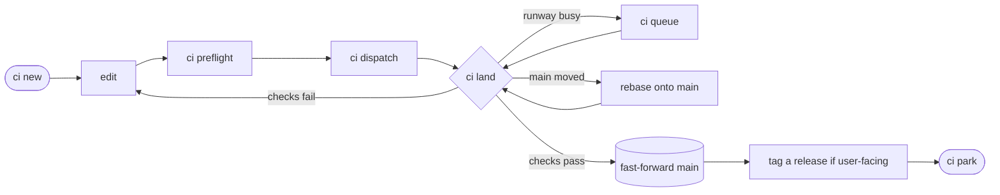

# ci

`ci` is my personal workflow for managing testing, merging, and deployment in
an opinionated way. It is a semi-automated, human-in-the-loop agent workflow:
it sets guardrails and a protocol for keeping several lines of work in progress
at once, runs tests and gates merges at defined points, and records metadata
about each change, such as which session owns it, what it declares it affects,
and which release it shipped in.

I usually let the MCP server manage it hands-off, but every step is also an
ordinary terminal command.

It developed through trial and error, not from any particular framework or
methodology. It is built around my own repositories and machines, so it is not
meant to be adopted elsewhere as-is, but parts of it may spark ideas for your
own custom workflows.

## How it works

Each line of work is a _topic_: one [Jujutsu](https://docs.jj-vcs.dev/) change,
or a short series of them, in its own workspace. `main` moves only by
fast-forward, and only to a commit whose checks passed on that exact commit.
Landings on a machine take turns on a single runway, so one landing never
invalidates the test results of another.

The workflow is written in [Nushell](https://www.nushell.sh). The protocol is a
[constraint-based specification](JjCi.qnt) whose safety properties are
model-checked exhaustively. A Rust state machine built with
[statig](https://crates.io/crates/statig) implements the same protocol, and its
tests check it against the specification. `ci tower` is a terminal UI that
shows every topic, run, and release as it changes.



## Commands

| Command | What it does |
| --- | --- |
| `ci new -m MSG` | Start a topic on trunk in the current workspace. |
| `ci shape` | Ask Jev whether the topic's revisions should be split or squashed, and print the `jj` commands that would do it. |
| `ci preflight` | Run formatting and lint hooks on the current change. |
| `ci dispatch` | Rebase the topic onto trunk and push its branch for review. |
| `ci land` | Build every check on the exact head, fast-forward `main` to it, and tag a release for user-facing changes. |
| `ci park` | Confirm the topic landed, delete its branch, and free the workspace. |

The [full workflow](docs/workflow.md) documents the rest, including parallel
workspaces, the landing queue, impact classes, and recovery.

## Running it

Nix is the only prerequisite; the package brings its own Nushell, Jujutsu,
Git, and GitHub CLI. Install Nix, for example with the
[Determinate Nix Installer](https://github.com/DeterminateSystems/nix-installer),
then run this in a Jujutsu repository:

```nu
nix run github:schlich/ci -- status
```

## Design choices

The project deliberately uses the newest versions of common tools. Working
with them gave me a tighter handle on the underlying concepts. The same
workflow could be built with traditional tools such as Git and Bash, but less
elegantly.

### VCS

> **Why Jujutsu?** Git identifies work only by commit hash, and amending or
> rebasing a commit gives it a new hash, so nothing stable is left to attach
> review history or metadata to. Jujutsu separates changes from commits. A
> [change](https://docs.jj-vcs.dev/latest/glossary/#change) keeps one change
> ID as it is rewritten, and each rewrite gets a new commit ID.
> `ci` keys ownership, impact declarations, and review snapshots to change IDs,
> so they survive the rebases that every dispatch and landing performs. Stable
> change IDs are also what make
> [interdiff review](https://blog.tangled.org/stacking#the-interdiff-model)
> (comparing successive versions of a patch series) and
> [stacked pull requests](https://www.stacking.dev/) practical.

### Automation and scripting

> **Why Nushell?** Nushell is bash with types. Most of `ci` is glue between
> `jj`, `gh`, `nix`, `systemd`, and JSON state files. Nushell parses their
> output into structured records and tables, so the scripts work with named
> fields instead of parsing text.

### Judgment calls

A few steps around the workflow need judgment rather than a fixed rule, such
as deciding why a deployment rolled back. For those I use
[Jev](https://docs.typesafe.ai/introduction), TypeSafe's "System One" model.
A Jev request is not a chat prompt. It carries _state_, a JSON record of the
evidence such as a revert report, and a set of typed _questions_ about that
state. Jev answers each question with numbers rather than prose:

- A **choice** picks one of several named options and says how confident it
  is.
- A **noul** gives the probability that a statement about the state is true.
- A **score** places the state on a scale of ordered, described levels.

Ordinary code makes the final decision by comparing those numbers with
thresholds I set. An answer that falls short of its threshold counts as
unsure, and the code handles that case explicitly instead of acting on a
guess; a failed request is treated the same way. The questions and thresholds
are declared as data beside the code that reads them, so they are reviewed
like code and retuned when the model version changes.

For example, a deployment of my machines is staged and reverts itself when
health checks fail. `deploy-reverts causes`, in my
[dotfiles](https://tangled.org/schlich.tngl.sh/dotfiles), asks Jev the
following about each revert report. It then ranks causes by how many reverts a
check before deployment could have caught, which tells me what check to add
to the landing gate next.

```nu
deploy_reverts: {
  min_confidence: 0.6
  min_catchable: 0.6
  questions: {
    cause: {
      type: choice
      instructions: "What caused the staged NixOS switch in `revert` to revert or be rejected? ..."
      criteria: {
        evaluation_or_build: "The configuration failed to evaluate or build, so nothing was activated"
        service_failure: "A system service failed to start or crashed after activation ..."
        flaky_probe: "The health probe itself misfired or timed out while the system was healthy"
        # ...five more classes
      }
    }
    precheck_catchable: {
      type: noul  # a probability that the statement is true
      instructions: "A check run before deployment, such as a flake check, an evaluation assertion, or a NixOS VM test, could have caught what made the switch in `revert` fail."
    }
  }
}
```

Inside `ci` itself, `ci shape` uses Jev to decide whether a topic should be
split or squashed before it is dispatched. For each revision it asks whether
the revision bundles more than one deliverable, and whether each changed file
serves what the revision's description says it does. For each pair of
revisions it asks whether the later one fixes up the earlier one, builds on
it, or stands alone. Code turns those answers into advice. It splits out the
files that serve something else, and a second request asks whether the two
parts need each other, which decides whether the split-out part goes before
the rest, after it, or into a topic of its own. It squashes each fixup into
the revision it fixes, and moves revisions that nothing else in the topic
depends on into their own topic. It prints the `jj split`, `jj squash`, or
`jj rebase` command for each piece of advice and runs none of them.
