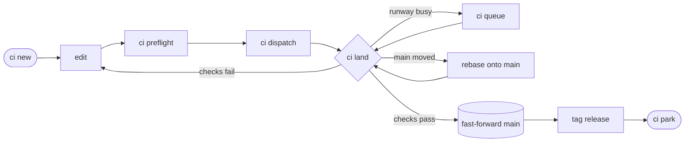

# ci

`ci` is the trunk-based workflow I use for [Jujutsu](https://jj-vcs.github.io/jj/)
repositories that several AI agent sessions and I change at once. It keeps
each session on its own topic and lands one topic at a time, fast-forwarding
`main` only to the exact commit its checks passed.

It is written in Nushell, with a Rust state machine and terminal UI, a
[Quint](https://quint-lang.org) model of the protocol, Nix for builds and
checks, and an MCP server so agents run the same commands people do.



## Running it

Try it in any Jujutsu repository with Nix:

```nu
nix run github:schlich/ci -- status
```

To keep it, add this repository as a flake input and install
`packages.<system>.ci`. To work on `ci` itself, enter `nix develop`, then run
`nix flake check` to check the model, the state machine, and the property
tests. [docs/workflow.md](docs/workflow.md) covers every command.
